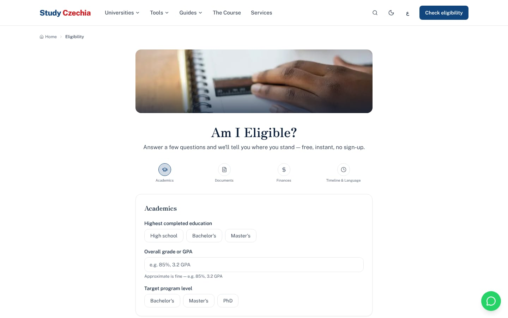
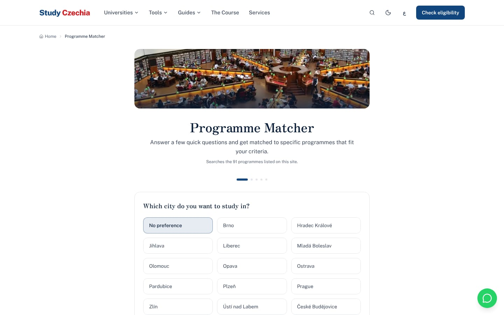
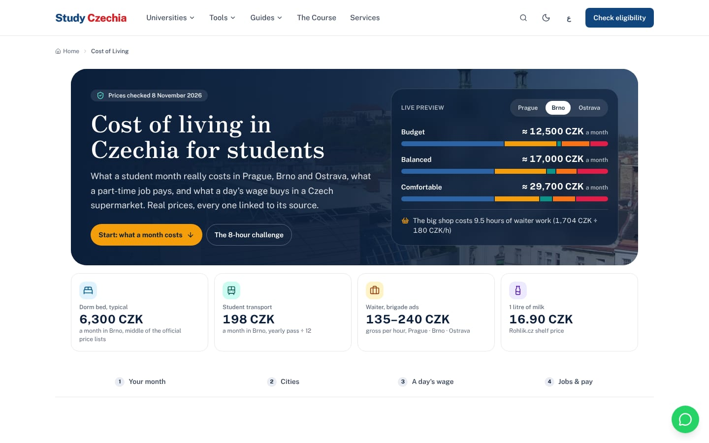
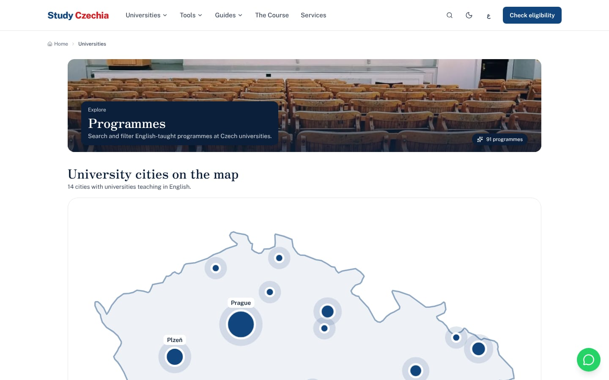
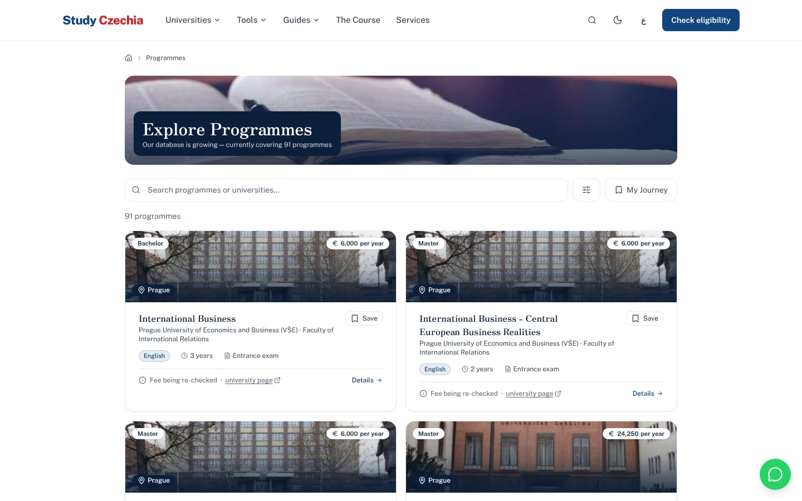
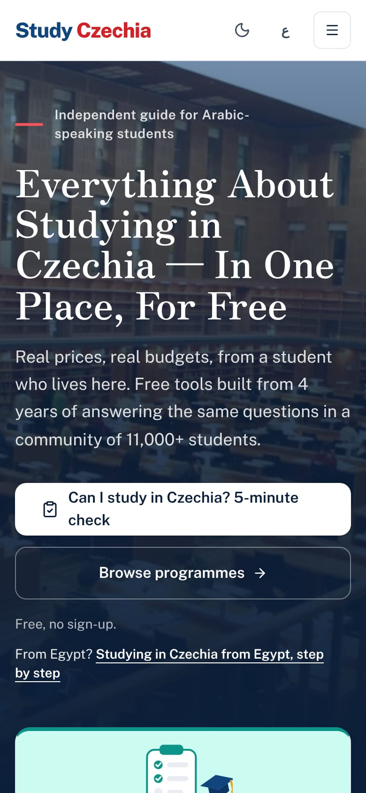
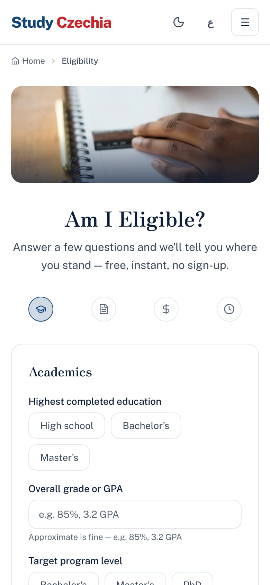

# Study Czechia

**A bilingual website (English and Arabic) that helps students from the Arab world study at universities in the Czech Republic.**

Live site: **[studyczechia.com](https://studyczechia.com)**

I designed, built and run this website on my own. It grew out of four years of answering the same questions in a Facebook community of more than 11,000 students. Instead of answering one by one, I turned the answers into free tools and guides that anyone can use.

> This repository is a public copy of the real project, shared to show my work. Private details such as phone numbers, live payment links and internal notes have been replaced or removed. Everything else is the real code that runs the live site.


---

## What the website does

- **"Am I eligible?" check:** a student answers a few questions and gets a clear result, the risks to fix and a step-by-step plan.
- **University matcher:** suggests universities and programmes that fit the student's field, budget and grades.
- **Programme database:** 91 English-taught programmes at 41 Czech universities. Every tuition fee comes from the university's own website, with the source link and the date it was checked.
- **Cost-of-living calculator:** a realistic monthly budget for each Czech city: rent, food, transport and part-time work.
- **Guides:** visa steps, documents, embassy interview prep, recognition of school certificates (Egypt, Jordan, Saudi Arabia), housing and arrival.
- **Full Arabic version:** every page has an Arabic twin that reads right to left, with its own search-engine details.
- **Online course and paid services:** online payment, with a members-only video course protected by secure sign-in links.

## Screenshots

| Eligibility check | University matcher |
|---|---|
|  |  |

| Cost of living | Universities |
|---|---|
|  |  |

| Programmes | Arabic version |
|---|---|
|  |  |

**On a phone** (designed for phones first, since most visitors use one):

<p>
  
  
  
</p>

## In numbers

- **524 pages**, half of them in Arabic
- **91 programmes** and **41 universities**, with sourced fees
- **392 automated tests** that run on every change
- Checked for **accessibility** (WCAG AA) and **speed** (Lighthouse budgets) on every change

## Skills this project shows

| Area | What I used |
|---|---|
| Front end | Next.js 16, React 19, TypeScript, Tailwind CSS, Framer Motion |
| Two languages | English and Arabic, right-to-left layout, translated page metadata |
| Back end | Serverless functions on Netlify, signed access tokens, protected video links |
| Payments and email | Stripe, Brevo |
| Quality | Vitest and Testing Library, ESLint, GitHub Actions, Lighthouse CI, axe accessibility checks |
| SEO and privacy | Sitemaps, structured data, `hreflang`, cookie-free analytics (Umami) |

---

## For developers

The site is a **static export** (`output: "export"`): every page is pre-built to HTML and served from a CDN. The only server code is a few Netlify Functions in `netlify/functions/` for the course and email.

```bash
npm ci
cp .env.example .env.local   # optional: analytics and email settings
npm run dev                  # http://localhost:3000
```

Checks:

```bash
npx tsc --noEmit   # types
npm run lint       # ESLint
npx vitest run     # tests
npm run build      # static export into out/
```

### Project layout

- `src/app/` pages (English at `/…`, Arabic at `/ar/…`, generated with `npm run gen:ar`)
- `src/components/` shared UI
- `src/data/` universities, programmes, fees and costs, each with its source
- `src/config/` prices, payment links and contact details (placeholders in this copy)
- `netlify/` serverless functions for the course and email
- `test/` automated tests
- `tools/` build, accessibility and performance scripts

The paid course content lives in a separate private repository and is downloaded at build time, so it is never in this code.

## License

MIT, see [LICENSE](LICENSE).
